<div align="center">
  
</div>

<br/>

<table>
<tr>
<td valign="top" width="66%">

### <samp>01 · about</samp>

Software Engineer focused on shipping **end-to-end products**. From cross-platform mobile apps to AI-powered web platforms. I work at the intersection of engineering and design: clean logic and visual craft aren't opposites: the best products demand both.

- Co-founder of **EngScan** - 1st place at PICS 2024, accelerated by the Centelha program
- Full-stack developer on **Career Angel**, an AI career platform for US higher education
- Final-year Software Engineering student at iCEV - 3× AWS certified
- Based in Teresina, Brazil - building for international markets

```python
focus = ["product engineering", "mobile", "backend & cloud", "applied ai"]
mode  = "remote-first · international"
```

<sub><samp>off the clock - video editing, photo editing, and games.</samp></sub>

</td>
<td valign="top" width="34%" align="center">

<br/>


<sub><samp>always brewing</samp></sub>

</td>
</tr>
</table>

<br/>

### <samp>02 · building now</samp>

<table>
<tr>
<td valign="top" width="50%">

<b>Career Angel</b> · <sub><samp>FULL-STACK · CONTRACT</samp></sub>

<sub>AI-powered career platform for US higher education. Semantic search with vector embeddings, AI assessment pipelines, and real-time background job infrastructure - built end to end.</sub>

<code>Next.js 16</code> <code>TypeScript</code> <code>Supabase · pgvector</code> <code>xAI · OpenAI</code> <code>Trigger.dev</code>

</td>
<td valign="top" width="50%">

<b>EngScan</b> · <sub><samp>CO-FOUNDER · MOBILE LEAD</samp></sub>

<sub>B2B SaaS that turns field inspections into AI-generated structural reports for civil engineers. 1st place at PICS 2024 · backed by the Centelha accelerator.</sub>

<code>Flutter</code> <code>Dart</code> <code>Python</code> <code>PostgreSQL</code> <code>Stripe</code>

</td>
</tr>
</table>

<br/>

### <samp>03 · stack</samp>

<div align="center">

<br/>

[](https://github.com/erlandsonjr)

<br/>

</div>

### <samp>04 · aws certifications</samp>

<div align="center">

<br/>

<a href="https://www.credly.com/badges/da343aa5-1c4d-4d49-be80-3584f2e1019c/public_url">
  
</a>
&nbsp;
<a href="https://www.credly.com/badges/d136c17f-0f09-46aa-9e0a-be442d820fbb/public_url">
  
</a>
&nbsp;
<a href="https://www.credly.com/badges/83d6b299-6165-4038-9428-0a163bb7b7fc/public_url">
  
</a>

<sub><samp>click a badge to verify on credly</samp></sub>

<br/>

</div>

### <samp>05 · featured work</samp>

<table>
<tr>
<td valign="top" width="33%">

<b><a href="https://github.com/erlandsonjr/FacialPoint-Reconhecimento-Facial">FacialPoint</a></b>

<sub>Facial-recognition time tracking - employees clock in via real-time webcam recognition. Microservices across four repos: React frontend, Node API, two FastAPI AI services.</sub>

<code>React</code> <code>Node.js</code> <code>FastAPI</code> <code>dlib</code>

</td>
<td valign="top" width="33%">

<b><a href="https://github.com/erlandsonjr/the-expurgation-in-cygnus">The Expurgation in Cygnus</a></b>

<sub>Roguelike action-survival game - 10 waves of escalating combat, upgrade-card choice matrix, data-driven design with ScriptableObjects. 32-bit pixel art, original soundtrack.</sub>

<code>Unity 6</code> <code>C#</code> <code>URP</code>

</td>
<td valign="top" width="33%">

<b><a href="https://github.com/erlandsonjr/video-frame-extractor">Video Frame Extractor</a></b>

<sub>Desktop tool for extracting high-quality frames from video - drag-and-drop, configurable intervals, zoomable gallery, threaded processing, multi-format export.</sub>

<code>Python</code> <code>PySide6</code> <code>OpenCV</code>

</td>
</tr>
</table>

<br/>

### <samp>06 · connect</samp>

<div align="center">

<br/>

<a href="https://www.linkedin.com/in/erlandsonjr">
  
</a>
&nbsp;
<a href="mailto:erlandsonjunior@outlook.com">
  
</a>

<sub><samp>open to remote roles - full-time or contract · US / CA / UK</samp></sub>

<br/>
<br/>

</div>

<div align="center">
  
</div>
